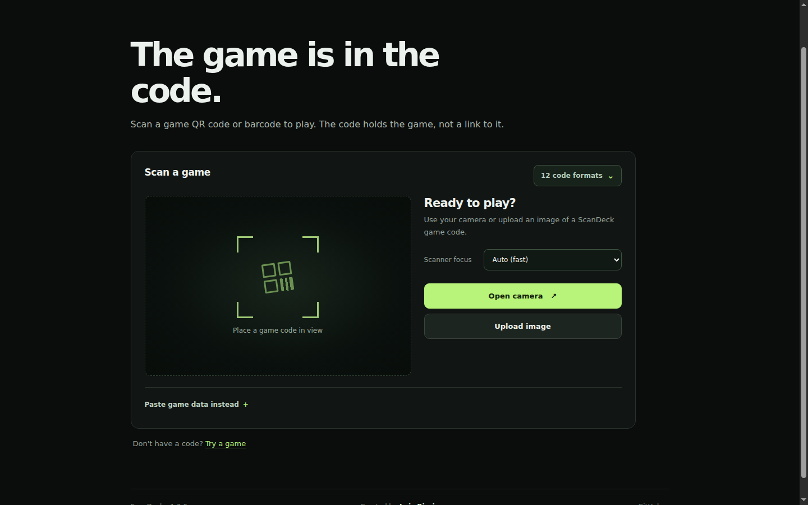

  
  <h1>ScanDeck</h1>
  
<strong>The game is in the code.</strong>

  
Play small games stored inside QR codes, barcodes and color codes. The code holds the game, not a website link.

  

    
    
    
    
  

  

    <a href="https://scandeck.luizbizzio.com/"><strong>Open the website</strong></a> ·
    <a href="#how-to-use">How to use</a> ·
    <a href="#games-and-code-formats">Games</a> ·
    <a href="SECURITY.md">Security</a>
  

## Play from a code

ScanDeck is a browser arcade. You do not need to install an app or create an account. Open the website on your phone or computer to scan, play or create a game.

### How to use

1. **Open [ScanDeck](https://scandeck.luizbizzio.com/).**
2. **Scan:** select **Start camera** and point it at a ScanDeck game code. You can also upload a code image.
3. **Games:** explore the included games. Select **Play**, **Download code** or **View source**.
4. **Create:** choose a code format, enter your supported game content and generate your own code.

**Scanning tip:** use good light and keep the whole code in view. If **Auto** cannot read a symbol, select its format or upload the image instead. IRIS, ChromaQR and DotCode use experimental readers, so results can vary by camera.

## Games and code formats

Every game in the library uses a different code format.

| Game | Format | Game | Format |
| :--- | :--- | :--- | :--- |
| Ironpass | QR Code | Tap Rush | Code 128 |
| Dice Streak | MicroPDF417 | Neon Dodge | DotCode |
| Catch 10 | Data Matrix | Pattern Memory | Aztec |
| Brick Rush | PDF417 | Perfect Timing | EAN-13 |
| Pocket Reflex | Micro QR | Codebreaker | GS1 DataBar Expanded Stacked |
| Wire Crisis | IRIS | Chroma Rush | ChromaQR |

## What is inside the code?

ScanDeck labels the games based on the data stored in their symbols.

| Label | Meaning |
| :--- | :--- |
| **Full** | The code stores a complete game in HTML or JavaScript. |
| **Partial** | The code stores game JavaScript. ScanDeck provides the page to display it. |
| **Bytecode** | The code stores small instructions. ScanDeck uses a local interpreter to play them. |

None of these labels means that a code is only a link to a hosted game.

## Good to know

- **Works on phones and computers.** Camera scanning needs browser permission.
- **Local scanning.** Game codes and uploaded images are decoded in your browser.
- **Offline support.** The site can work offline after its files have been saved by the browser.
- **Safe use.** Only play codes from sources you trust. Games run in a sandboxed frame, but no sandbox removes every risk.
- **Camera limits.** Some codes work better through image upload than through a live camera.

See the [security policy](SECURITY.md) to report a vulnerability, or use [GitHub Issues](https://github.com/luizbizzio/scandeck/issues) for normal bugs.

## License

Created by [Luiz Bizzio](https://github.com/luizbizzio). ScanDeck's original code is licensed under [Apache 2.0](LICENSE). Third-party components keep their own licenses. See [NOTICE](NOTICE).
